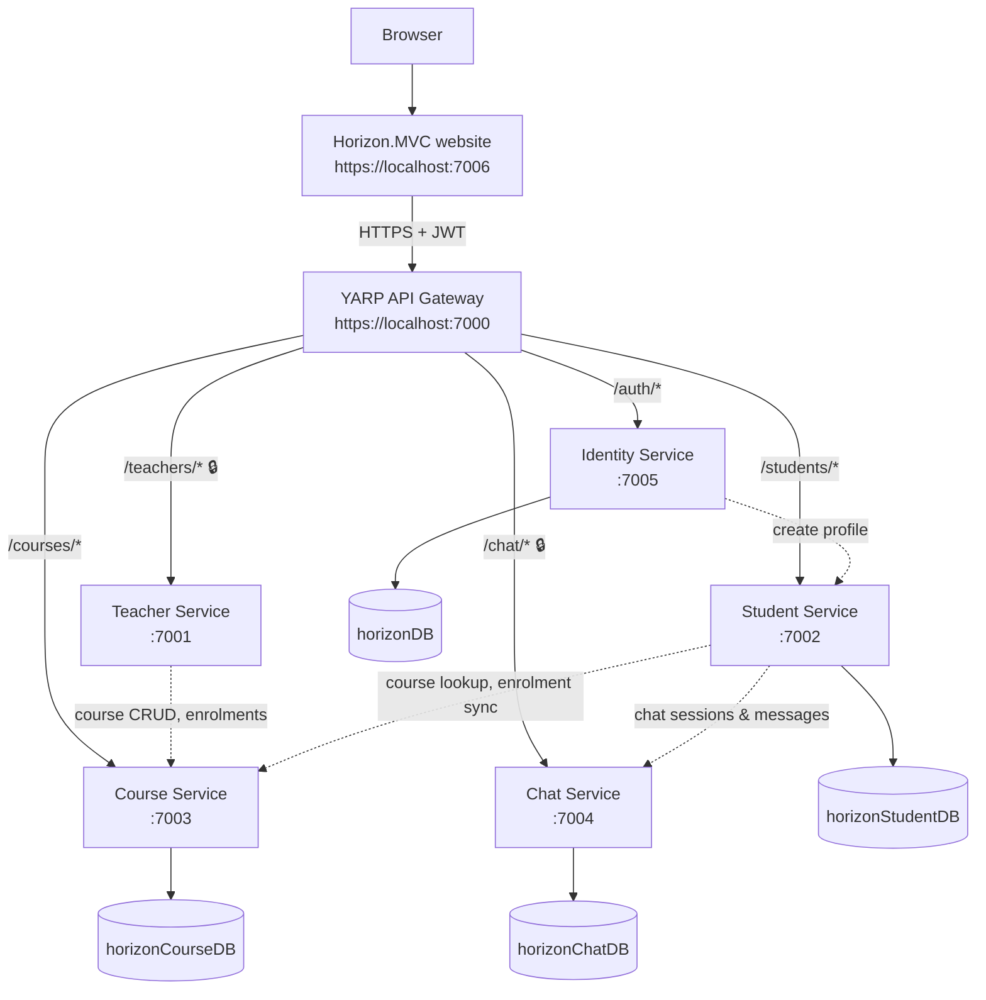

# 🌅 Horizon – Microservices Learning Platform (.NET 10)

Horizon is an e-learning platform built to practise **how requests travel through an API gateway** to a set of independent microservices. One MVC website talks to a **YARP gateway**, and the gateway routes each request to one of five backend services. Every data-owning service has its own **PostgreSQL** database (hosted on [Neon](https://neon.tech) or run locally) and logs with **Serilog**.

> 📖 **New to the project?** Open [`docs/horizon-guide.html`](docs/horizon-guide.html) in a browser. It is a beginner-friendly, illustrated walkthrough of how everything works.

---

## 🏛️ Architecture



🔒 = the gateway itself requires a valid JWT on this route. Dotted lines are direct service-to-service HTTP calls.

### Services

| Project | Path | Port (HTTPS) | Responsibility | Database |
| :-- | :-- | :-: | :-- | :-- |
| **Horizon.MVC** | `Horizon.MVC/` | 7006 | Server-rendered website for students, teachers and admins | – (cookie + session) |
| **Gateway** | `gateway/GatewayAPI/` | 7000 | Routing, JWT validation (teacher/chat), rate limiting (100 req / 10 s → `429`) | – |
| **Identity** | `services/identity-service/` | 7005 | Register, login, JWT issuing, teacher approval, admin seed | `horizonDB` |
| **Teacher** | `services/teacher-service/` | 7001 | Teacher dashboard and course workflow (calls Course) | – |
| **Course** | `services/course-service/` | 7003 | Courses, videos, comments, enrolments | `horizonCourseDB` |
| **Student** | `services/student-service/` | 7002 | Profile, dashboard, bookmarks, progress, recommendations, enrolling | `horizonStudentDB` |
| **Chat** | `services/chat-service/` | 7004 | Student ↔ teacher chat sessions and messages | `horizonChatDB` |

### Gateway routes

| Public path | Forwarded to | Notes |
| :-- | :-- | :-- |
| `/auth/{**}` | Identity `:7005` | prefix `/auth` removed |
| `/students/{**}` | Student `:7002` | prefix removed, rate limited |
| `/courses/{**}` | Course `:7003` | prefix removed, rate limited |
| `/teachers/{**}` | Teacher `:7001` | requires JWT, rate limited |
| `/chat/{**}` | Chat `:7004` | requires JWT, rate limited |

Example: `GET https://localhost:7000/courses/api/CoursesApi` reaches the Course service as `GET /api/CoursesApi`.

### Authentication

- **People** authenticate with a **JWT** (60 min) issued by Identity at `POST /auth/api/Auth/login`. The same `Jwt:Key / Issuer / Audience` must be configured in the gateway, identity, course, student and teacher services.
- **Teachers** must be approved by an **Admin** before they can log in.
- **Services** calling each other without a user (Identity → Student profile creation, Student → Course enrolment sync) send a shared secret in the `X-Service-Key` header, checked against `ServiceAuth:Key`.

---

## ⚙️ Prerequisites

1. **.NET 10 SDK**
2. A **PostgreSQL** server: a free [Neon](https://neon.tech) project (recommended) or local PostgreSQL 16+
3. The HTTPS dev certificate trusted once: `dotnet dev-certs https --trust`
4. *(Optional)* `dotnet tool install --global dotnet-ef` to create new migrations

## 🗄️ Database setup

Each data service creates and migrates **its own database on startup**, so you only need a running server and the four empty databases:

| Service | Config key | Database name |
| :-- | :-- | :-- |
| Identity | `ConnectionStrings:DefaultConnection` | `horizonDB` |
| Course | `ConnectionStrings:DefaultConnection` | `horizonCourseDB` |
| Student | `ConnectionStrings:DefaultConnection` | `horizonStudentDB` |
| Chat | `ConnectionStrings:WebApplication1Context` | `horizonChatDB` |

The committed `appsettings.json` files contain only a harmless `localhost … Password=CHANGE_ME` placeholder. Put your **real** connection string in **user-secrets** (stored on your computer, never committed):

```powershell
cd services/identity-service
dotnet user-secrets set "ConnectionStrings:DefaultConnection" "Host=ep-xxxx.neon.tech;Database=horizonDB;Username=neondb_owner;Password=YOUR_PASSWORD;SSL Mode=Require;Timeout=30"

cd ../course-service
dotnet user-secrets set "ConnectionStrings:DefaultConnection" "Host=ep-xxxx.neon.tech;Database=horizonCourseDB;Username=neondb_owner;Password=YOUR_PASSWORD;SSL Mode=Require;Timeout=30"

cd ../student-service
dotnet user-secrets set "ConnectionStrings:DefaultConnection" "Host=ep-xxxx.neon.tech;Database=horizonStudentDB;Username=neondb_owner;Password=YOUR_PASSWORD;SSL Mode=Require;Timeout=30"

cd ../chat-service
dotnet user-secrets set "ConnectionStrings:WebApplication1Context" "Host=ep-xxxx.neon.tech;Database=horizonChatDB;Username=neondb_owner;Password=YOUR_PASSWORD;SSL Mode=Require;Timeout=30"
```

At startup .NET merges settings from `appsettings.json` → user-secrets (Development only) → environment variables, and the **later source wins**. Servers can use environment variables instead, e.g. `ConnectionStrings__DefaultConnection`. Full Neon walkthrough (creating the four databases, pitfalls such as database-name capitalisation): [`database_setup_neon.md`](database_setup_neon.md).

### Other settings

| Key | Where | Purpose |
| :-- | :-- | :-- |
| `Jwt:Key`, `Jwt:Issuer`, `Jwt:Audience` | gateway, identity, course, student, teacher | Must be identical so every service accepts tokens from Identity |
| `ServiceAuth:Key` | identity, student, course | Shared secret for service-to-service calls (must match) |
| `Admin:Email`, `Admin:Password` | identity | Admin account seeded on first start |
| `ServiceUrls:*`, `StudentApi:BaseUrl` | student, teacher, identity | Addresses of other services |
| `GatewayUrl` | Horizon.MVC | Where the website sends every API call |
| `AutoMapper:LicenseKey` | chat, course, identity | Optional free key; without it AutoMapper only logs a notice |

> The defaults (JWT key, `ServiceAuth:Key`, admin account `krish@learningplatform.com` / `Krish@123`) are for **local learning only**. Move them to user-secrets or environment variables before deploying anywhere public.

---

## 🚀 Run

```powershell
./run-all.ps1
```

This opens seven windows (gateway, identity, teacher, course, chat, student, MVC). In Visual Studio you can use the multi-start profile `integration.slnLaunch` instead. Then open **https://localhost:7006**.

Typical first run:
1. Register a **Student** and a **Teacher** on the website.
2. Log in as the admin and approve the teacher.
3. Log in as the teacher, create and publish a course.
4. Log in as the student, enrol in the course, and start a chat.

Every service has Swagger at `https://localhost:<port>/swagger` in Development (Chat shows it on its root page).

### Try the gateway from a terminal

```bash
# public data
curl -k https://localhost:7000/courses/api/CoursesApi
# protected route without a token -> 401 from the gateway
curl -k -i https://localhost:7000/teachers/api/teacher/courses
# log in (admin) and use the returned token
curl -k -X POST https://localhost:7000/auth/api/Auth/login -H "Content-Type: application/json" \
     -d '{"email":"krish@learningplatform.com","password":"Krish@123"}'
```

Stop one service (for example Course) and call its route: the gateway answers `502` while the other routes keep working.

---

## 🧱 Tech stack

| Area | Technology |
| :-- | :-- |
| Runtime | .NET 10, ASP.NET Core |
| Gateway | YARP `Yarp.ReverseProxy` 2.3.0 |
| Data | EF Core 10.0.9 + `Npgsql.EntityFrameworkCore.PostgreSQL` 10.0.2, ASP.NET Identity |
| Auth | JWT Bearer (`Microsoft.AspNetCore.Authentication.JwtBearer` 10.0.9) |
| Validation / mapping | FluentValidation 11.12, AutoMapper 15.1.1 |
| Resilience | Polly 7.2.4 (retry) in student and teacher services; `RetryHandler` in the MVC app |
| Logging | Serilog (console + daily rolling files) |
| API docs | Swashbuckle 8.1.0 |
| Frontend | Razor views, Tailwind CSS / Bootstrap / jQuery via CDN |

All package versions are pinned (no floating `*` versions).

## 📝 Logging

The gateway and all five services use **Serilog**: output goes to the console and to a daily file in each project's `logs/` folder (git-ignored): `gateway-log`, `authentication-`, `teacher-service-`, `log-` (course, student) and `API_Log-` (chat). The MVC website uses default .NET console logging.

## 📂 Repository layout

```text
Horizon/
├── Horizon.MVC/              website (Controllers, Services, Handlers, Views, Areas/Admin, Pages)
├── gateway/GatewayAPI/       YARP gateway: Program.cs + routes in appsettings.json
├── services/
│   ├── identity-service/     login, users, JWT            (horizonDB)
│   ├── teacher-service/      teacher workflow             (no DB)
│   ├── course-service/       courses, enrolments          (horizonCourseDB)
│   ├── student-service/      student features             (horizonStudentDB)
│   └── chat-service/         chat                         (horizonChatDB)
├── docs/horizon-guide.html   illustrated beginner guide
├── database_setup_neon.md    PostgreSQL / Neon setup
├── run-all.ps1               start everything
├── integration.slnx          solution
└── integration.slnLaunch     Visual Studio multi-start profile
```

Each service follows the same layers: `Controllers → Validators → Services → Repositories → Data (DbContext)`, with `Middleware/` for error handling and `Migrations/` for the database schema.

## ⚠️ Known limitations

- **Chat** has no authentication of its own: it relies on the gateway. Always reach it through `https://localhost:7000/chat/...`.
- Only the Student service's `/api/profile` endpoints check a token; other student endpoints, and the student/course/auth gateway routes, are open.
- The Course `progress` notification endpoint only logs the message.
- Teacher-side chat integration is a placeholder (returns an empty list).
- No automated tests yet.

## 🙌 Credits

Built as a hands-on project for learning API gateways and microservice communication with .NET.
